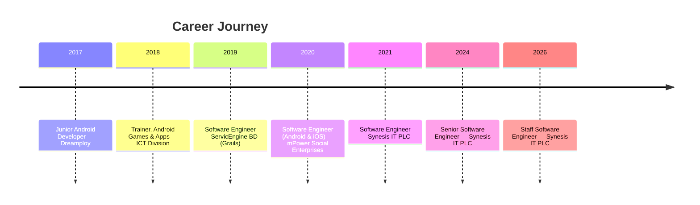
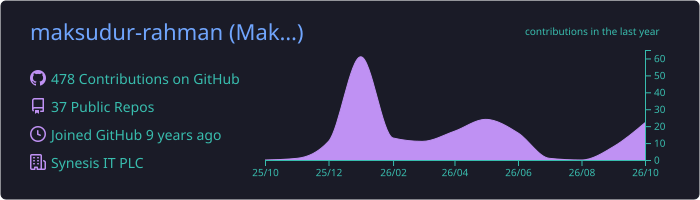
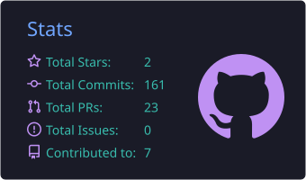
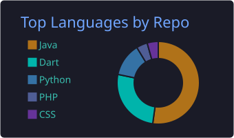
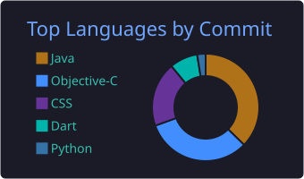

<!-- ═══════════════════════════ HEADER ═══════════════════════════ -->
<p align="center">
  
</p>

<p align="center">
  <a href="https://github.com/maksudur-rahman">
    
  </a>
</p>

<p align="center">
  <a href="https://www.linkedin.com/in/maksudurrahman44"></a>
  <a href="https://maksudur-rahman.github.io"></a>
  <a href="https://pub.dev/packages/convay_hls_player"></a>
  <a href="https://convay.com"></a>
</p>

<p align="center">
  
  
  
  
</p>

---

##  About Me

<table>
<tr>
<td width="58%" valign="top">

I build **high-performance mobile apps and SDKs** — React Native, Flutter and native iOS / Android — with a focus on **real-time communication** (WebRTC, Jitsi Meet, Matrix).

- 🏢 **Staff Software Engineer** at **[Synesis IT PLC](https://synesisit.com.bd)** — leading mobile architecture for **[Convay](https://convay.com)**
- 🌍 Convay streamed the **South Africa Presidential Symposium (G20 partnership)** to ministers from **30+ African countries** with live multilingual subtitles
- 📦 Shipped public **Android & iOS SDKs** used by external developers via **Maven, CocoaPods & SPM**
- ⚙️ Migrated **6+ production React Native / Flutter apps & SDKs** to Android's **16 KB page-size** requirement
- 🤖 Driving **AI-powered features** inside mobile products
- 🎓 B.Sc. in CSE, **Jahangirnagar University** (CGPA 3.70 / 4.00)
- 🔬 Research interests: **Machine Learning, Deep Learning & Computer Vision**
- 💬 Ask me about **mobile architecture, WebRTC, SDK design, app security**

</td>
<td width="42%" valign="top">

```kotlin
data class Engineer(
    val name: String = "Maksudur Rahman",
    val nickname: String = "Rotno",
    val role: String = "Staff Software Engineer",
    val company: String = "Synesis IT PLC",
    val location: String = "Dhaka, Bangladesh 🇧🇩",
    val mobile: List<String> = listOf(
        "React Native", "Flutter",
        "iOS", "Android"
    ),
    val realtime: List<String> = listOf(
        "WebRTC", "Jitsi", "Matrix", "HLS"
    ),
    val currentlyBuilding: String =
        "Convay Meet & Convay Chat",
    val openToMentor: Boolean = true
)
```

</td>
</tr>
</table>

---

## 🛠️ Languages & Frameworks

<p align="center">
  <a href="https://skillicons.dev">
    
  </a>
  <br/><br/>
  <a href="https://skillicons.dev">
    
  </a>
</p>

<details open>
<summary><b>📱 Mobile</b></summary>
<br/>


</details>

<details open>
<summary><b>💻 Languages</b></summary>
<br/>


</details>

<details open>
<summary><b>📡 Real-time Communication & Streaming</b></summary>
<br/>


</details>

<details open>
<summary><b>🧩 Libraries & Architecture</b></summary>
<br/>


</details>

<details open>
<summary><b>☁️ Backend, Databases & Cloud</b></summary>
<br/>


</details>

<details open>
<summary><b>🧠 AI / ML & Computer Vision</b></summary>
<br/>


</details>

<details open>
<summary><b>🧰 Tools, DevOps & Distribution</b></summary>
<br/>


</details>

---

## 🎯 Skills & Expertise

| Area | What I do |
|---|---|
| 🏗️ **Mobile Architecture** | Technical direction for multi-platform apps, MVVM / Clean Architecture, modularisation, design & code reviews |
| 📡 **Real-time Communication** | WebRTC audio/video, group calling, screen sharing, Jitsi Meet SDK, Matrix / Element Call integration |
| 📦 **SDK Development** | Designing, versioning and publishing native SDKs (Maven, CocoaPods, SPM) and Flutter / RN plugins |
| 🎥 **Video Streaming** | Low-latency HLS playback, adaptive bitrate, token refresh, native player bridges |
| 🔐 **Mobile App Security** | Hardening against reverse engineering, secure storage, SSL pinning, root/jailbreak detection, pentest fixes |
| ⚡ **Performance & Build** | Android 16 KB page-size migration, Hermes / New Architecture, Gradle & Xcode build optimisation, CI pipelines |
| 🤖 **AI in Mobile** | Integrating AI-powered meeting features (live translation, subtitles) into production apps |
| 👨‍🏫 **Leadership** | Mentoring engineers, setting code-quality standards, turning business needs into scalable technical plans |

---

## 💼 Experience



<details>
<summary><b>🏢 Synesis IT PLC</b> — Staff Software Engineer <i>(Oct 2026 – Present)</i> · Senior SE <i>(2024 – 2026)</i> · SE <i>(2021 – 2024)</i></summary>
<br/>

- Lead technical direction and architecture for **Convay's** mobile apps (React Native, Flutter, native iOS & Android), used across **30+ countries**
- Design and own **WebRTC-based** real-time features and the SDKs other teams and partners build on
- Integrated **Element Call** (Matrix / WebRTC) for group calling in **Convay Chat**
- Drive integration of **AI-powered features** into mobile products
- Set engineering standards for code quality, performance and reliability; mentor engineers
- Also worked on **EkPay** (national bill-payment platform) and **Ek Desh** (crowdfunding platform of Bangladesh)

</details>

<details>
<summary><b>🏥 mPower Social Enterprises</b> — Software Engineer, Android & iOS <i>(2020 – 2021)</i></summary>
<br/>

- Built Android & iOS apps for public health: **BRAC mHealth**, **CBHC MHV** (DGHS, Ministry of Health), **Paintology**
- Contributed to **OpenSRP** — open-source mobile health platform for frontline health workers

</details>

<details>
<summary><b>⚙️ ServicEngine Bangladesh</b> — Software Engineer <i>(2019 – 2020)</i></summary>
<br/>

- Built products on **Groovy on Grails**; created **Image Forensics Lab** (Android + desktop image-metadata & RGB analysis tool)

</details>

<details>
<summary><b>🎓 ICT Division</b> — Trainer, Android Games & Applications <i>(2018 – 2019)</i> · <b>Dreamploy</b> — Junior Android Developer <i>(2017 – 2018)</i></summary>
<br/>

- Trained developers under the national *Skill Development for Mobile Game and Application* programme

</details>

---

## 🚀 Featured Work

<table>
<tr>
<td width="50%" valign="top">

### 🎥 Convay Meet
Enterprise, AI-powered video conferencing for iOS & Android — HD audio/video, screen sharing, polls, virtual backgrounds, live multilingual subtitles. Official streaming partner of the **South Africa Presidential Symposium 2025 (G20)**.

`WebRTC` `Jitsi` `React Native` `Kotlin` `Swift`

</td>
<td width="50%" valign="top">

### 💬 Convay Chat
Secure team messaging with real-time chat and calling, built on **Matrix**, with **Element Call** for group video.

`Matrix` `Element X` `WebRTC` `Kotlin` `Swift`

</td>
</tr>
<tr>
<td width="50%" valign="top">

### 📦 Convay SDK — Android & iOS
Public native SDKs that let developers embed Convay meetings in their own apps. Android via **Maven**, iOS via **CocoaPods & SPM**.

`SDK Design` `Maven` `CocoaPods` `SPM`

</td>
<td width="50%" valign="top">

### 📺 [convay_hls_player](https://pub.dev/packages/convay_hls_player)
Flutter plugin for secure, low-latency **HLS** live streaming on Android & iOS — native players, token refresh, adaptive bitrate.

`Flutter` `Dart` `ExoPlayer` `AVPlayer`

</td>
</tr>
</table>

---

## 📌 Open-Source Projects

<p align="center">
  <a href="https://github.com/maksudur-rahman/convay-hls-player"></a>
  <a href="https://github.com/maksudur-rahman/flutter-chat-app-firebase"></a>
  <a href="https://github.com/maksudur-rahman/Car-Wash-Mobile"></a>
  <a href="https://github.com/maksudur-rahman/vehicle-speed-check-from-input-video-python"></a>
  <a href="https://github.com/maksudur-rahman/object-detection-using-SIFT"></a>
  <a href="https://github.com/maksudur-rahman/maksudur-rahman.github.io"></a>
</p>

**Open-source contributions:** [Jitsi Meet](https://github.com/jitsi/jitsi-meet) (mobile apps & SDK) · [Element X Android](https://github.com/element-hq/element-x-android) · [Element X iOS](https://github.com/element-hq/element-x-ios) · [Element Call](https://github.com/element-hq/element-call) · [OpenSRP](https://github.com/opensrp)

---

## ✍️ Recent Articles

| | Article |
|---|---|
| 🛡️ | [How to Secure Your Android & iOS App From Every Real-World Threat](https://www.linkedin.com/in/maksudurrahman44/recent-activity/articles/) |
| 📐 | [Android 16 KB Page Size — Complete Guide + Real Migration Experience](https://www.linkedin.com/in/maksudurrahman44/recent-activity/articles/) |
| ⚡ | [12 Techniques That Cut iOS, Android & Cross-Platform Build Times in Half](https://www.linkedin.com/in/maksudurrahman44/recent-activity/all/) |

---

## 📊 GitHub Analytics

<p align="center">
  
</p>
<p align="center">
  
  
  
</p>
<p align="center">
  
</p>
<p align="center">
  
</p>

### 🐍 Contribution Snake

<p align="center">
  <picture>
    <source media="(prefers-color-scheme: dark)" srcset="https://raw.githubusercontent.com/maksudur-rahman/maksudur-rahman/output/github-contribution-grid-snake-dark.svg" />
    <source media="(prefers-color-scheme: light)" srcset="https://raw.githubusercontent.com/maksudur-rahman/maksudur-rahman/output/github-contribution-grid-snake.svg" />
    
  </picture>
</p>

---

## 🎓 Education & Certifications

| | |
|---|---|
| 🎓 **B.Sc. in Computer Science & Engineering** | Jahangirnagar University · 2015 – 2018 · CGPA **3.70 / 4.00** |
| 📘 **HSC, Science** | Government Science College · 2011 – 2013 · GPA **5.00** |
| 🏅 **Android Certification** | TestDome · 2019 |

---

## 🌱 Currently

- 🔭 Working on **Convay Meet** and **Convay Chat** — mobile apps and SDKs
- 🤖 Bringing **AI features** (live translation, smart meeting tools) to mobile
- 📚 Exploring **Kotlin Multiplatform**, **React Native New Architecture** and on-device ML
- 🤝 Open to **collaborate** on mobile, WebRTC and SDK projects — and happy to **mentor**

## ⚡ Fun Facts

- 🏆 My apps have been used by **government ministers across 30+ countries**
- 🧑‍🏫 Before shipping enterprise apps, I **trained developers** for Bangladesh's ICT Division
- 🔍 I once built an **image forensics** app that tells you which device and software edited a photo

---

## 🤝 Let's Connect

<p align="center">
  <a href="https://www.linkedin.com/in/maksudurrahman44"></a>
  <a href="https://maksudur-rahman.github.io"></a>
  <a href="https://github.com/maksudur-rahman?tab=repositories"></a>
</p>

<p align="center">
  
</p>

<p align="center">
  
</p>
